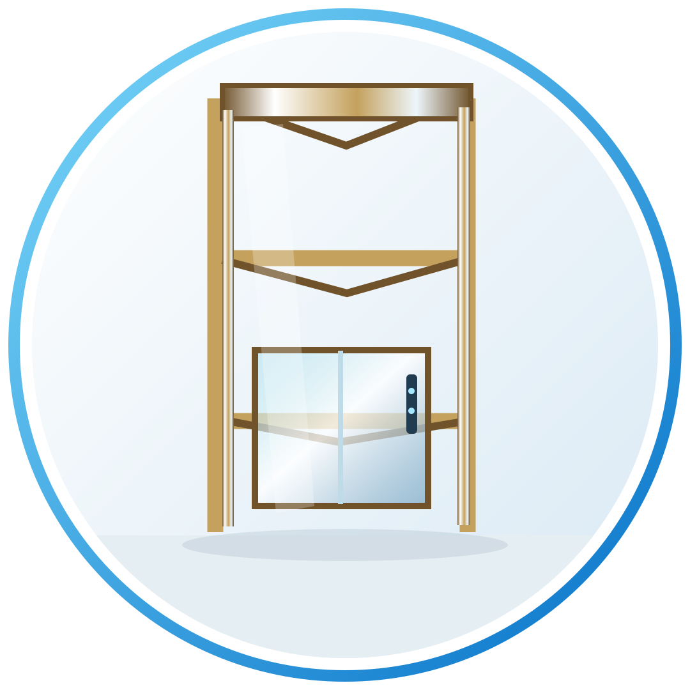
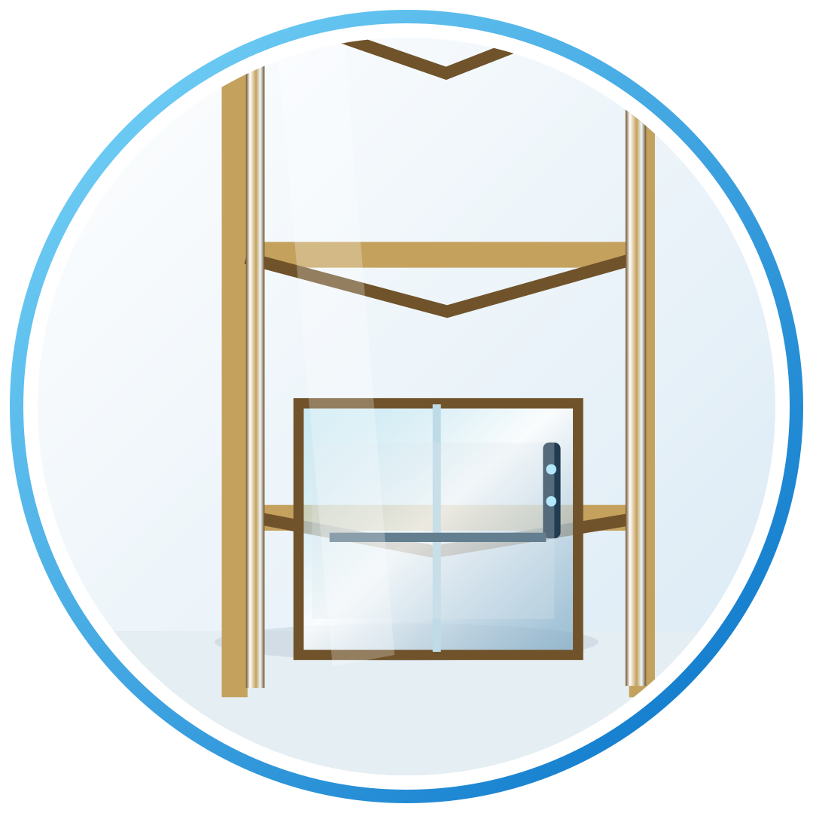
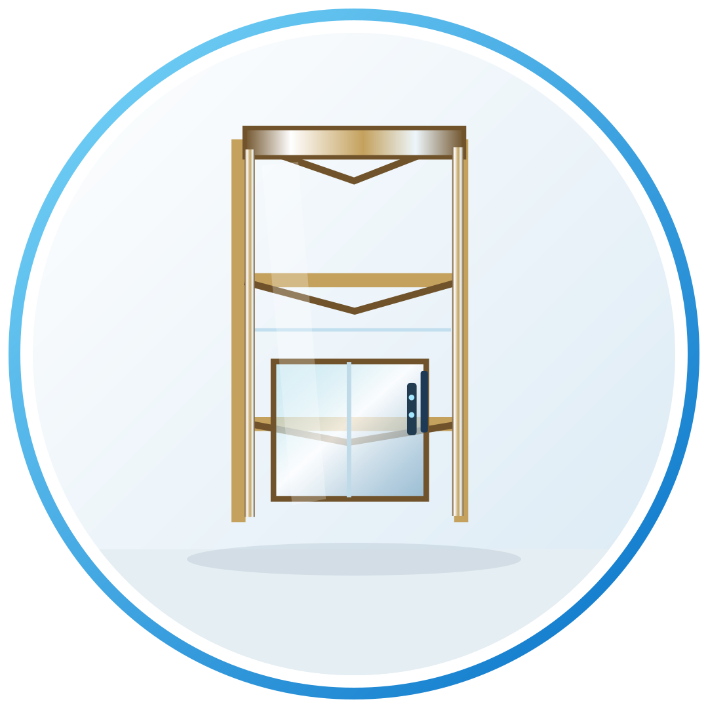

# Thang máy biệt thự S9 – khung rồng môn nhỏ gọn

**Mã dòng:** S9 忘忧

**Phân loại:** Khung rồng môn nhỏ gọn

| Thông số | Theo catalogue |
|---|---|
| Giếng thang tối thiểu | 1.250 × 1.250 mm |
| Hố pit tối thiểu | 250 mm |
| Chiều cao đỉnh giếng tối thiểu | 2.900 mm |
| Chiều cao tối thiểu có phần khung trên | — |
| Tốc độ danh định | 0,3 m/s |
| Mẫu cabin tùy chọn | S9-01, S9-02, S9-03, S9-04 |

Nguồn: Catalogue *20260421电梯样册.pdf*, trang PDF 10–11, 20.

> **Lưu ý:** Các SVG trong hồ sơ web là hình minh họa dựng lại theo kiểu kết cấu, không phải ảnh chụp hoặc ảnh chính thức của hãng. Bộ ảnh gốc được trích trực tiếp từ PDF và cung cấp trong file Excel. Catalogue hiện chưa đủ thông tin xác nhận tên pháp nhân nhà sản xuất, tải trọng, công suất điện, thời hạn bảo hành, mức giá và chứng nhận.

Liên hệ hệ thống HSEVN để đối chiếu bản vẽ và cấu hình trước khi báo giá.
